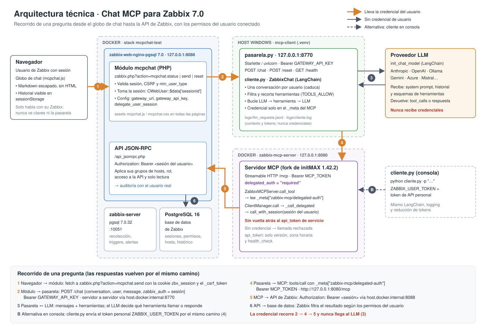

# Proyecto MCP · Chat en lenguaje natural para Zabbix

Asistente que responde preguntas sobre la monitorización de Zabbix en lenguaje natural
(«¿qué problemas graves hay ahora?», «¿cómo está el host web01?») **con los permisos del usuario que
pregunta**. Se usa desde un globo de chat integrado en la interfaz de Zabbix 7.0 o desde la consola.

Combina un LLM (cualquier proveedor, vía LangChain) con un servidor MCP que expone la API de Zabbix
como herramientas: el LLM decide qué consultar, el servidor MCP lo consulta en Zabbix y el LLM redacta
la respuesta con los datos reales.

## Esquema



Esquema en [docs/arquitectura.svg](docs/arquitectura.svg) (versión PNG: [docs/arquitectura.png](docs/arquitectura.png)).

## Componentes

| Carpeta | Qué es | Detalle |
|---|---|---|
| [zabbix-module-mcpchat/](zabbix-module-mcpchat/) | Módulo de frontend para Zabbix 7.0 (PHP + JS). Añade el globo de chat en todas las páginas y envía las preguntas, junto con la sesión del usuario, a la pasarela. | [README](zabbix-module-mcpchat/README.md) |
| [mcp-client/](mcp-client/) | Cliente en Python con LangChain: pasarela HTTP para el globo (`pasarela.py`), chat en consola (`cliente.py`) y análisis del consumo de tokens (`analizar_contexto.py`). | [README](mcp-client/README.md) |
| [zabbix-mcp-server/](zabbix-mcp-server/) | Fork del servidor MCP de [initMAX](https://github.com/initMAX/zabbix-mcp-server) (v1.42.2), con **autenticación delegada**: consulta Zabbix con la credencial de cada usuario en vez de una cuenta de servicio. | [README del upstream](zabbix-mcp-server/README.md) |
| [docs/](docs/) | Documentación común (esquema de arquitectura). | |

## Cómo funciona

1. El usuario escribe en el globo de chat de Zabbix.
2. El módulo comprueba su sesión, sus permisos y el token CSRF, y envía la pregunta junto con la sesión
   del usuario a la pasarela, de servidor a servidor.
3. La pasarela pregunta al LLM, que decide qué herramientas de Zabbix necesita.
4. La pasarela llama a esas herramientas en el servidor MCP, con la sesión del usuario en los metadatos
   de cada llamada.
5. El servidor MCP consulta la API de Zabbix **con esa sesión**: Zabbix aplica los grupos de hosts, el
   rol y las restricciones del usuario.
6. Los datos vuelven al LLM, que redacta la respuesta que aparece en el globo.

## Puntos clave

- **Permisos del usuario, no de una cuenta de servicio.** Con `delegated_auth = "required"`, el servidor
  MCP rechaza cualquier llamada sin credencial de usuario y nunca recurre a su propio `api_token`.
- **La credencial nunca llega al LLM** ni se escribe en los logs: solo viaja entre el módulo, la pasarela
  y el servidor MCP.
- **Independiente del modelo:** Anthropic, OpenAI, Ollama, Gemini, Azure… se elige con `LLM_PROVIDER`
  y `LLM_MODEL`.
- **Consumo de tokens controlado:** el catálogo completo de herramientas son ~195.000 tokens por petición.
  El cliente filtra y recorta herramientas, resultados e historial, y registra qué se envía en cada
  petición para poder analizarlo.

## Puesta en marcha (resumen)

La forma rápida es el asistente interactivo, que solo necesita Python ≥ 3.10:

```powershell
python puesta_en_marcha.py
```

Crea `zabbix-mcp-server/config.toml` y `.env`, y `mcp-client/.env`, a partir de sus ejemplos. Pide los
valores necesarios (URL y token de Zabbix, modo de autenticación delegada, proveedor y modelo del LLM…),
genera los tokens aleatorios y, si se le pide, rellena `gateway_url` y `gateway_api_key` en el
`manifest.json` del módulo. No escribe nada hasta confirmar el resumen. Si un fichero ya existe, pregunta
antes de sobrescribirlo y guarda una copia `.bak`. Al acabar muestra los comandos de arranque.

A mano:

1. **Servidor MCP**: configura `zabbix-mcp-server/config.toml` (URL de Zabbix, `api_token`,
   `auth_token`, `delegated_auth = "required"`) y arráncalo (Docker o `.venv`).
2. **Pasarela**: copia `mcp-client/.env.example` a `.env` (LLM, `MCP_URL`, `MCP_TOKEN`,
   `GATEWAY_API_KEY`, `TOOLS_ALLOW`) y ejecuta `python pasarela.py`.
3. **Módulo**: ajusta `config` en `zabbix-module-mcpchat/manifest.json` (`gateway_url`,
   `gateway_api_key`), cópialo a `modules/mcpchat` del frontend de Zabbix y habilítalo en
   *Administración → General → Módulos*.

El paso a paso de cada parte está en el README de su carpeta.

## Para desarrollar

Las instrucciones para agentes de IA (y el registro de personalizaciones del fork) están en
[AGENTS.md](AGENTS.md): permiten pedir cambios en el MCP en lenguaje natural.
