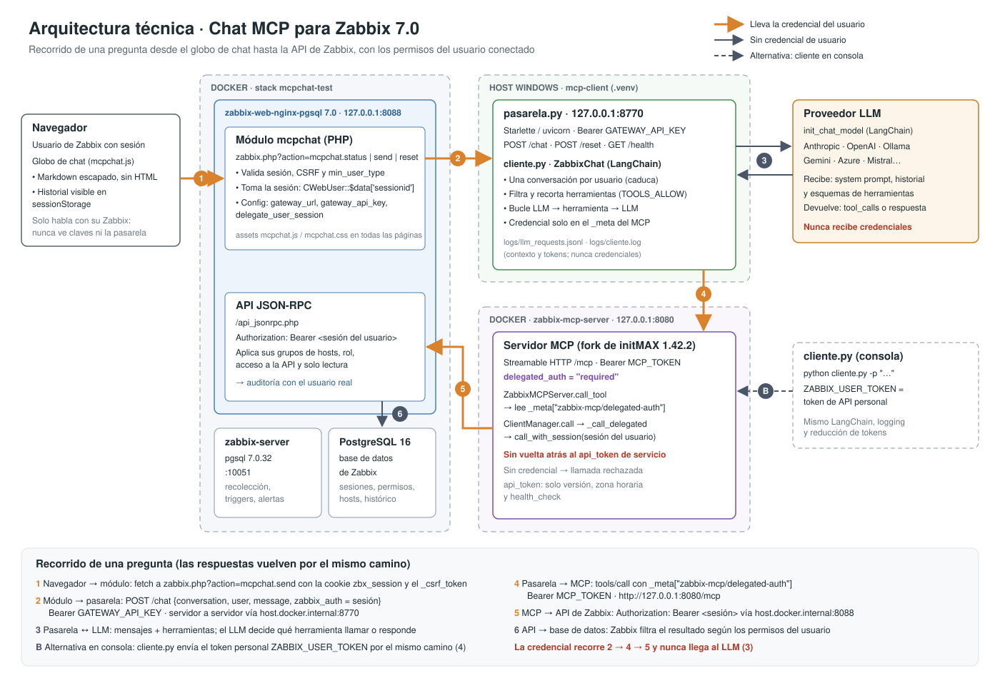

# MCP Chat: módulo de Zabbix 7.0

Añade a **todas las páginas** del frontend de Zabbix 7.0 un globo de chat flotante, abajo a la derecha,
para consultar la monitorización en lenguaje natural. Las preguntas las responde un LLM compatible con
OpenAI que usa las herramientas del servidor MCP de Zabbix ([../zabbix-mcp-server](../zabbix-mcp-server)).

```
Navegador ──(misma sesión de Zabbix + CSRF)──▶ zabbix.php?action=mcpchat.*   (este módulo, PHP)
                                                   │  POST JSON + Bearer (servidor a servidor)
                                                   ▼
                                       pasarela.py  (../mcp-client)  ──▶ LLM compatible OpenAI
                                                   │
                                                   ▼
                                       zabbix-mcp-server  ──▶ API de Zabbix
```



El navegador solo habla con Zabbix. La URL y la clave de la pasarela, la clave del LLM y el token del MCP
nunca llegan al navegador.

## Contenido

| Fichero | Función |
|---|---|
| `manifest.json` | Declaración del módulo, acciones, assets y configuración por defecto. |
| `actions/ChatBase.php` | Configuración, permisos, id de conversación y llamada HTTP a la pasarela (cURL o streams). |
| `actions/ChatStatus.php` | `mcpchat.status` (GET): ¿puede este usuario usar el chat? + tokens CSRF. |
| `actions/ChatSend.php` | `mcpchat.send` (POST JSON + CSRF): envía la pregunta y devuelve la respuesta. |
| `actions/ChatReset.php` | `mcpchat.reset` (POST JSON + CSRF): empieza una conversación nueva (botón ⟳ de la cabecera, con confirmación). La pasarela lo rechaza si hay una pregunta en curso. |
| `assets/js/mcpchat.js` | Globo y panel de chat (JS sin dependencias). Renderiza Markdown con todo el HTML escapado. |
| `assets/css/mcpchat.css` | Estilos, con soporte de temas claros y oscuros de Zabbix. |

## Instalación

1. **Pasarela** (en un equipo que alcance el LLM y el servidor MCP):
   ```bash
   cd mcp-client
   cp .env.example .env     # LLM, MCP, TOOLS_ALLOW... y GATEWAY_API_KEY (clave larga aleatoria)
   python pasarela.py       # escucha en GATEWAY_HOST:GATEWAY_PORT (127.0.0.1:8770 por defecto)
   ```
   Si el frontend de Zabbix está en otra máquina, pon `GATEWAY_HOST=0.0.0.0` y limita el acceso
   con el cortafuegos a la IP del frontend.

2. **Configura el módulo antes de registrarlo**: edita `config` en `manifest.json`. Zabbix copia esa
   configuración a su base de datos al registrar el módulo y después ya no vuelve a leerla del fichero.

   | Clave | Por defecto | Significado |
   |---|---|---|
   | `gateway_url` | `http://127.0.0.1:8770` | URL de la pasarela vista **desde el servidor web** de Zabbix. |
   | `gateway_api_key` | `""` | La misma `GATEWAY_API_KEY` de la pasarela. Alternativa recomendada: la variable de entorno `MCPCHAT_GATEWAY_API_KEY` del PHP-FPM/servidor web, que tiene prioridad y no se guarda en la base de datos. |
   | `min_user_type` | `3` | Tipo mínimo de usuario: 1 = User, 2 = Admin, 3 = Super admin. Los invitados nunca ven el chat. |
   | `timeout` | `180` | Segundos máximos de espera de una respuesta (el LLM puede encadenar varias herramientas). |
   | `title` | `Asistente Zabbix` | Título del panel. |
   | `delegate_user_session` | `true` | Envía la sesión del usuario conectado: el chat consulta Zabbix **con sus permisos** (ver Seguridad). |

3. **Copia la carpeta** al directorio de módulos del frontend con el nombre `mcpchat`:
   - Paquetes de Zabbix 7.0: `/usr/share/zabbix/modules/mcpchat`
   - Instalación desde código fuente: `<raíz del frontend>/modules/mcpchat`

4. En Zabbix: **Administración → General → Módulos → Escanear directorio**, y luego **Habilitar** "MCP Chat".
   Recarga la página: el globo aparece abajo a la derecha para los usuarios con permiso.

Para **cambiar la configuración después**, usa la API (`module.update` con `config` completo), o
deshabilita el módulo, bórralo de la lista, edita `manifest.json` y vuelve a escanear.

## Seguridad

- **El chat consulta Zabbix con los permisos del usuario conectado** (`delegate_user_session = true`).
  El módulo envía la sesión del usuario a la pasarela, servidor a servidor. La pasarela la reenvía al
  servidor MCP en cada llamada a herramienta, y el MCP la usa como credencial de la API de Zabbix.
  Zabbix aplica sus grupos de hosts, su rol (incluido «acceso a la API» y los métodos permitidos) y su
  modo de solo lectura. En Zabbix 7.0 la sesión del frontend es válida como `Bearer` en la API.
  - El servidor MCP debe tener **`delegated_auth = "required"`** en `[server]` (opción del fork, ver
    `config.example.toml`). Así nunca responde con su propia cuenta de servicio, aunque falte la credencial.
  - Si la sesión caduca o el rol del usuario no tiene acceso a la API, el chat muestra el error de Zabbix.
    No se reintenta con la cuenta de servicio.
  - La sesión no se guarda en la pasarela ni en los logs, y nunca llega al LLM.
  - Con `delegate_user_session = false` se vuelve al modelo anterior: el chat usa la credencial de servicio
    del MCP, así que usa un token de solo lectura y limita `min_user_type`.
- Aun con delegación, deja en `TOOLS_ALLOW` de la pasarela solo las herramientas que quieras ofrecer.
  Si un usuario tiene permisos de escritura en Zabbix, un LLM con herramientas de escritura podría usarlos.
- Las acciones que cambian estado exigen el token CSRF de Zabbix. El id de conversación es un hash de
  usuario + sesión: el id de sesión real no sale del frontend y cada inicio de sesión empieza conversación nueva.
- Las respuestas del LLM se muestran escapadas (Markdown básico, sin HTML), así que un texto malicioso
  procedente de Zabbix o del LLM no se puede ejecutar en el navegador.
- La pasarela registra las preguntas, el usuario y el contexto completo en `mcp-client/logs/`. Trátalos
  como datos sensibles.

## Problemas frecuentes

| Síntoma | Causa probable |
|---|---|
| No aparece el globo | Módulo no habilitado; usuario por debajo de `min_user_type`; caché del navegador (recarga con Ctrl+F5). |
| "No se puede contactar con la pasarela" | `gateway_url` no es alcanzable desde el servidor web (¿pasarela parada, `127.0.0.1` en otra máquina, cortafuegos?). Detalle en el log de errores de PHP (`[mcpchat]`). |
| "rechazó la autenticación" | `gateway_api_key` / `MCPCHAT_GATEWAY_API_KEY` no coincide con `GATEWAY_API_KEY`. |
| "Tu sesión ha caducado" | Sesión de Zabbix cerrada o token CSRF antiguo: recarga la página. |
| "Session terminated, re-login" / "No permissions" en la respuesta | La sesión delegada ya no vale o el rol del usuario no tiene acceso a la API o a ese método: es Zabbix aplicando sus permisos. |
| "This server only answers on behalf of a Zabbix user" | `delegate_user_session = false` en el módulo, pero el MCP tiene `delegated_auth = "required"`. |
| "La conversación anterior caducó" | La pasarela olvidó la conversación (inactividad de `GATEWAY_IDLE_MINUTES`, `GATEWAY_MAX_CONVERSATIONS`, reinicio de la pasarela o ⟳ en otra pestaña). La respuesta ya no tiene en cuenta los mensajes anteriores. |
| Respuestas lentas o caras | Revisa `TOOLS_ALLOW` y los ajustes de tokens de la pasarela (`mcp-client/README.md`) y analiza con `python analizar_contexto.py`. |

Compatibilidad: probado con Zabbix 7.0.32 (contenedores oficiales `alpine-7.0-latest`, manifest v2). Zabbix 7.2/7.4 usan el mismo sistema de módulos,
pero en los paquetes el directorio pasa a ser `/usr/share/zabbix/ui/modules/`.
